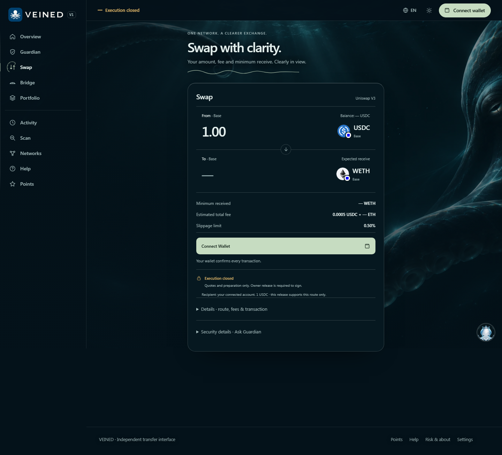
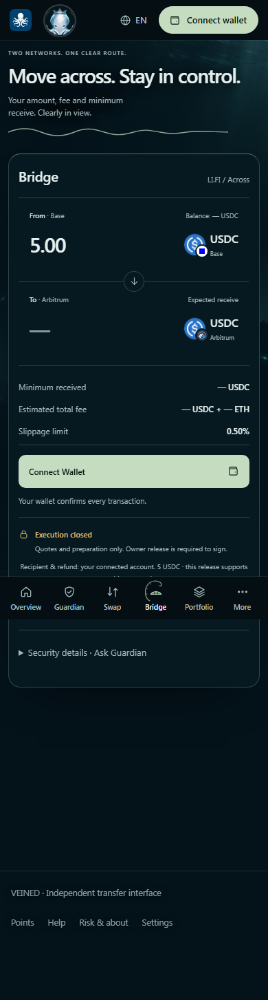

# VEINED

**Your portfolio, swaps and bridges, with Guardian checking every supported transaction.**

VEINED brings wallet assets, supported DeFi positions, transaction review and settlement tracking into one ocean-inspired interface. Our long-term vision is access across **300+ networks**. That vision is broader than today's execution scope: this development candidate prepares only the two routes below, and financial execution remains closed.

| Feature         | Current behavior                                                                                                                                                                       |
| --------------- | -------------------------------------------------------------------------------------------------------------------------------------------------------------------------------------- |
| Portfolio       | Read-only wallet balances and supported DeFi adapters, with explicit coverage, stale data and provider failures. Missing data is not a zero balance; unknown prices are not invented.  |
| Swap            | Base **1 USDC → WETH**, live on-chain review, balance, fee budget and minimum receive; reuse an adequate existing allowance, otherwise request an exact approval.                      |
| Bridge          | Base **5 USDC → Arbitrum USDC**, live provider quote and Across review, source receipt and independently verified destination fill. Pending, unknown and refund states remain visible. |
| Guardian        | Mandatory server-side identity, contract, spender, calldata, simulation, nonce, freshness and economic checks. BLOCK/HOLD stop execution. Detailed explanations are optional.          |
| Activity & Scan | Wallet-linked VEINED submissions, durable hash-chained journal, receipt recovery, public hash lookup and correlated source/destination evidence. Address coverage is partial.          |

## Execution status

`MANUAL_WALLET_RELEASED=false`. This is a **disarmed development and owner-review candidate**, not live production trading. Wallet connection and read-only quotes do not grant transaction authority. There is no request, cookie or environment switch that opens the financial gate.

The reviewed manual flow uses one main Swap or Bridge action. Each required on-chain transaction still needs its own explicit wallet confirmation. An approval must reach final success at the route's confirmation policy before a fresh execution quote is accepted. New independent records are allocated only after verified settlement, with prior single-use records retained. Unknown, rejected and crashed operations are never automatically reset or resent.

Manual review is pinned to a specific isolated local candidate and exact loopback origin. Other checkouts can preview the interface and public read APIs; their manual review correctly reports `MANUAL_CANDIDATE_ONLY`. Unsupported execution routes stay closed. See [development status](DEVELOPMENT_STATUS.md) and [owner canary preparation](docs/POST_HACKATHON_RELEASE.md).

## Local preview

Use Node.js 24 and pnpm 11.25.0. No private key, seed phrase or funded wallet is needed.

```sh
git clone https://github.com/veinedxyz/veined.git
cd veined
git switch post-hackathon/product-completion-20261117-01
pnpm install --frozen-lockfile --ignore-scripts
pnpm swap:deps
node scripts/post-hackathon-preview.mjs build
node scripts/post-hackathon-preview.mjs start
```

Open [Swap](http://127.0.0.1:3470/swap), [Bridge](http://127.0.0.1:3470/bridge), [Portfolio](http://127.0.0.1:3470/portfolio), [Activity](http://127.0.0.1:3470/activity) or [Scan](http://127.0.0.1:3470/scan). Stop with Ctrl+C. The launcher binds to loopback only and selects the external-wallet connection layer. RPC connectivity affects read-only data availability.

```sh
pnpm typecheck
pnpm lint
pnpm exec vitest run tests/unit tests/integration --maxWorkers=2
pnpm audit
```

The default safety scanner deliberately rejects manual financial composition. Only the exact, independently reviewed, disarmed local candidate can pass `node scripts/verify-safety.mjs --manual-wallet-candidate`. Neither this profile nor a successful build authorizes activation or deployment.

## NEAR Hackathon

The NEAR Hackathon work is preserved separately: deterministic Guardian verdicts and digests, NEAR accounts/access-key checks, dry NEAR Intents quotes, guarded Chain Signatures preparation and optional NEAR AI Cloud narration. These are distinct from the later Base manual-wallet work.

Read the [hackathon guide](HACKATHON.md) and the immutable [hackathon submission](https://github.com/veinedxyz/veined/tree/hackathon-submission) at commit [`7b0a73c`](https://github.com/veinedxyz/veined/commit/7b0a73cc27f557c5c01e151f7177eed4530ae927). Both `hackathon-submission` and `pre-hackathon` tags remain unchanged. [Engineering history](ENGINEERING_HISTORY.md) preserves prior milestones.

## Product views

These are genuine screenshots of the disarmed local application with no simulated balances or financial transaction proof.




## License and boundaries

See [LICENSE](LICENSE) for the existing evaluation terms; this update does not change them. Third-party dependencies, source excerpts and logos retain their respective licenses and notices. Public source availability is not a public hosting or production-readiness claim.
