# G7 P20 semantics and protected candidate — V1.12.1

P20 (`NO_WRITE_PATH_EXECUTED`) evaluates runtime execution evidence. Preparing calldata, showing an eligible button, consuming a capability at arm, and suppressing a dry send do not constitute a wallet request.

V1.12 inherited a mixed P20 gate from V1.7: a protected-source mismatch made `scanG7Sources().pass` false, which became `STATIC_SAFETY_SCAN_FAILED` inside P20. The accepted V1.11 source hashes matched, so that mixed predicate happened to pass then. V1.12's five source changes produced a release block without any write. The root cause was recorded before application edits in the V1.12.1 evidence root's `P20_ROOT_CAUSE.md`.

P20 now consumes `ExecutionEvidence`, shared by the read-only transport, preflight source and session. Counters are monotonic, snapshots are frozen, and persisted evidence restores monotonically. A prohibited RPC attempt is recorded before the allowlist guard rejects it, with no network dispatch. Missing, invalid or nonzero execution counters fail P20. A dry wallet-attempt API injection records and rejects the attempt, fails P20, and never asks a provider.

The protected-source scan, state overrides, production execution closure and fee policy remain independently blocking in **R1 `RELEASE_SECURITY_CONTROLS_PASS`**. A missing or invalid protected-baseline result also fails R1. Moving a reason changes its attribution; it does not remove the blocker. A fully ready pilot has all 28 P/S gates plus R1 passing.

## Session flow

```mermaid
stateDiagram-v2
  [*] --> CREATED
  CREATED --> PREFLIGHT_RUNNING
  PREFLIGHT_RUNNING --> BLOCKED: financial or release failure
  PREFLIGHT_RUNNING --> READY: all gates pass
  READY --> FINAL_PREFLIGHT_RUNNING: reviewed intent and bound wallet
  FINAL_PREFLIGHT_RUNNING --> BLOCKED: fresh failure
  FINAL_PREFLIGHT_RUNNING --> ARMABLE: exact intent and quote <=17 seconds
  ARMABLE --> DRY_RUN_COMPLETE: send suppressed; zero dispatch
  ARMABLE --> ARMED: real one-shot lock consumed; capability only
  ARMED --> ABORTED_BEFORE_WALLET_REQUEST: identity/quote/adapter refusal
  ARMED --> OWNER_WALLET_DECISION: explicit request attempt
  OWNER_WALLET_DECISION --> USER_REJECTED
  OWNER_WALLET_DECISION --> MANUAL_REVIEW_REQUIRED
  OWNER_WALLET_DECISION --> SENT: observed transaction hash
```

`walletRequestsIssued` no longer derives from ARMED. Actual request results supply issuance evidence; a separate attempt counter covers dispatch intent, including a pending request. An adapter refusal before issuance leaves the issuance counter zero. Neither field authorizes a retry. The existing one-shot lock, account/chain binding, final intent comparison, 17-second arm limit and 20-second wallet limit remain.

## Candidate validation boundary

The accepted 99-file manifest and `.otherbridge/g7-protected-baseline.txt` remain unchanged. Default verification still rejects changed protected hashes in R1, while P20 reports the actual no-write truth.

An explicit candidate path **and SHA-256** select candidate verification. The scanner requires every accepted path and the security additions, exact source hashes and the unchanged source-pattern checks. There is no environment-driven production baseline override. Launcher and runtime constructors refuse candidate authorization for live real mode; the session also requires an accepted-baseline source for a live real session. Candidate context is confined to read-only dry validation or isolated mock-wallet fixtures.

The six V1.12 additions remain security relevant: witness capability selection, strict log validation, token-specific in-flight reconciliation, checkpoint integrity, read-only release diagnostics and accepted-checkpoint import. V1.12.1 adds the execution-evidence ledger and the **unchanged** canonical wallet adapter to exact hash protection. The final candidate therefore contains **107 files**, with zero removals. The adapter's transaction comparison, active-session binding and sole provider dispatch make it part of the execution boundary; it was absent from the 105-file prep manifest.

`PROTECTED_BASELINE_V1121_REVIEW.json` records accepted/V1.12/V1.12.1 hashes, exact diffs, rationale, impact and coverage for every changed protected file. The separate invariant review is a primary-agent source review, not an external security audit. Independent acceptance is still an owner review step. Candidate readiness does not activate the accepted pointer or enable production execution.

## Verification scope

Existing READY regressions are retained. Test harnesses explicitly verify the candidate instead of mocking a successful scanner. Existing isolated mock-provider one-shot tests still exercise synthetic requests; the milestone's real-network acceptance uses no wallet object and suppresses arm in dry mode. No connected-wallet request, signing, approval, permit, raw transaction, broadcast, deployment or fee collection occurs.

The first ten dry sessions are retained as preliminary evidence. A final inspection made protected-baseline evidence mandatory and fail closed, so a second ten-session cohort verifies the final frozen source. Only that final cohort and the three sessions after all builds/tests/security scans are acceptance authority. The previous V1.12 30-run witness soak remains reliability context, not a substitute for these new P20 checks.

Common finalized pin, exactly three independent BSC groups, exact block hashes, age/floor bounds, dual ONE simulation, external cache anchors, reserve reconciliation and financial intent remain unchanged. The fixed intent digest is:

`4eecb9784961717f8464be8f9a650004974e328239f614211ad51bdf65aac869`

Normal product source, registries, logos, locales and UI were preserved. Public artifact separation and existing app/landing/docs budgets are checked again. The real-mode artifact is not built or served during this milestone.

## V1.12.1 measured closure

READY_FOR_REVIEW; candidate 12e308981ac25421adaf24bb5839e88d11e53a2e0568377e574569d8614f77ad (107 files), PROPOSED_BASELINE_READY_FOR_INDEPENDENT_ACCEPTANCE. Accepted 99-file pointer is unchanged. Live real mode remains R1-blocked until independent candidate acceptance; this report does not activate it.

Unit 973/973; integration 237/237; G7 targeted 354/354; standalone 11 required pass, 1 unchanged optional skip; product fixture 15 required pass, 3 unchanged optional skips. All 48 previous P20-linked failures are individually accounted for.

Final ten dry sessions 10/10 DRY_RUN_COMPLETE; final three after tests/build/security barrier 3/3 DRY_RUN_COMPLETE. Each passes 28/28 P/S gates plus R1, with P20 PASS and unchanged intent 4eecb9784961717f8464be8f9a650004974e328239f614211ad51bdf65aac869. All actual write/sign/wallet/approval/permit/broadcast/deploy/fee counters are zero. Production execution stays CLOSED.

Public initial gzip bytes remain app 274873, landing 143735, docs 144870; public client file hashes match V1.12. Evidence: evidence/otherbridge-v1-12-1/v1121-20261007T134055076Z-2a3af9/RESULTS.json. ZIP CRC/entry/archive verification is under review-bundle.
